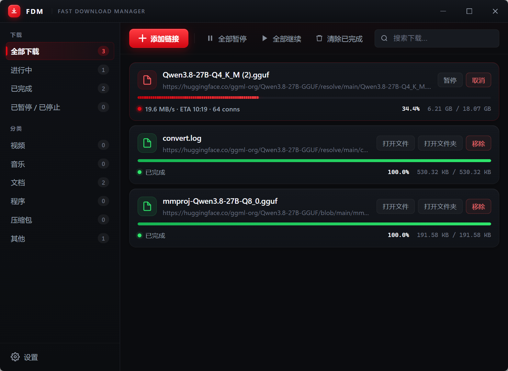
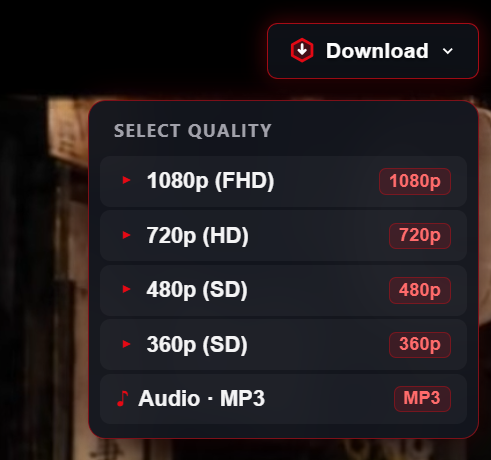
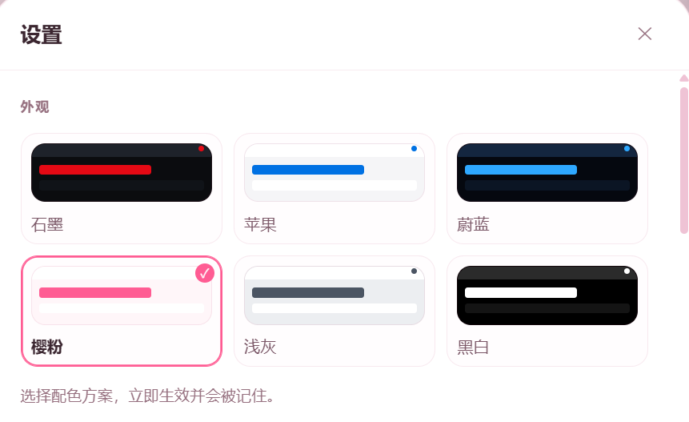

# FDM — Fast Download Manager

**Windows 上的多线程下载器 · 浏览器视频嗅探 · 13 种界面语言**

免广告 · 无遥测 · 安装即用

## 下载

[**→ 前往 Releases 下载最新版**](../../releases/latest)

每个版本发一个 Release，附安装包和该版更新说明。安装包未做代码签名，Windows 会提示
「未知发布者」，点 **更多信息 → 仍要运行**。

## 第一次运行

1. 双击安装包，UAC 提示点「是」——需要管理员权限注册浏览器本地通信组件。
2. 下载默认落在 `下载\FDM\{视频, 音乐, 压缩包, 程序, 文档, 其它}`；可在设置里改，
   也可以设为「记住上次保存位置」。
3. Chrome / Edge / Brave 扩展会自动注册；没生效就按下面「浏览器扩展」手动加载一次。
4. `yt-dlp`、`ffmpeg`、`deno` 已内置，视频嗅探不用另装东西。

## 功能

| 功能 | 说明 |
|---|---|
| **多线程加速** | 最多 64 条并行连接，绕开服务器单连接限速。实测 18 GB 文件 19.6 MB/s |
| **视频嗅探** | 画面上直接选 4K / 1440p / 1080p / 720p / 480p / 360p / MP3 |
| **断点续传** | 分段进度写入 `.fdm` 检查点，断电、断网、重启都能接着下 |
| **分类归档** | 视频、音乐、压缩包、程序、文档自动分流到不同文件夹 |
| **界面主题** | 6 套配色，设置 → 外观切换，即时生效、重启保持 |
| **界面语言** | 13 种，含简体中文 / 繁體中文 |
| **命令行** | `fdm.exe` 支持脚本化下载、自定义请求头、SHA-256 校验 |
| **无遥测** | 不收集使用数据，不联网检查版本 |

## 界面

主窗口 — 18 GB 大文件 19.6 MB/s、64 条并行连接，进度条按连接分段着色

视频嗅探 — 画面上直接列出可用画质，点一下交给 FDM 多线程抓取

设置 → 外观 — 6 套主题一键切换，重启后保持

## 浏览器扩展

安装包已经把扩展释放到 `C:\Program Files\FDM\extension`。如果按钮没出现：

1. 打开 `chrome://extensions`（Edge 为 `edge://extensions`）。
2. 打开右上角 **开发者模式**。
3. 点 **加载已解压的扩展程序**，选择 `C:\Program Files\FDM\extension`。
4. 回网页刷新一次，视频画面上就会出现下载按钮；普通下载链接也可以右键「使用 FDM 下载」。

## 常见问题

**下载比浏览器慢？** 程序已读取 Windows 系统代理并强制 HTTP/1.1。代理软件请用「系统代理」
模式，仅 TUN 模式不生效。

**任务列表清空了，设置还在吗？** 在。偏好单独存放在 `%LOCALAPPDATA%\FDM\prefs.json`。

**会替代 IDM 吗？** 不会。独立项目，跟 Internet Download Manager 没有任何关系。

## 更新

只在本页 **Releases** 发布，仓库本身不放安装包。想收更新通知：**Watch → Custom → Releases**。

## 说明

本仓库仅用于分发安装包，不包含源代码。程序基于 [Ahmad Farooq](https://github.com/ahmadfarooq)
的开源项目 **FDM**（Apache-2.0）二次开发，中文适配与构建由本仓库维护。

## 许可

[Apache-2.0](LICENSE)。按第 4(d) 条，再分发与衍生作品需保留 [NOTICE](NOTICE) 中
「Originally created by Ahmad Farooq」的署名；程序「设置 → 关于」也保留了这条署名。
