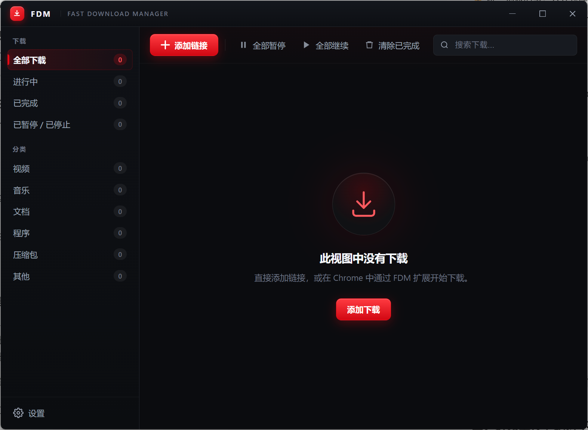
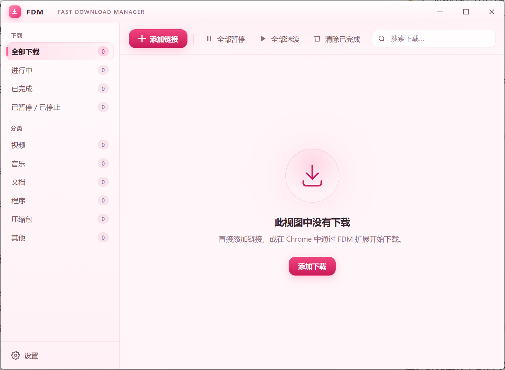
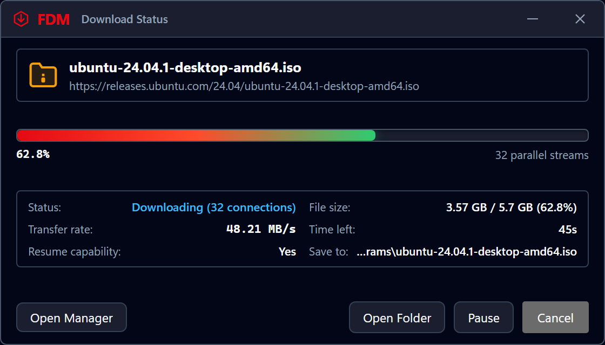

# FDM — Fast Download Manager

**面向 Windows 的高速多线程下载管理器 · 浏览器视频嗅探 · 12 种界面语言**

*免广告、无遥测、安装即用*

[下载安装](#-下载安装) • [功能](#-功能特性) • [截图](#-界面截图) • [浏览器扩展](#-浏览器扩展) • [常见问题](#-常见问题) • [许可](#-许可与署名)

 

---

> [!NOTE]
> 本仓库**只发布 Windows 安装包与说明文档，不包含源代码**。
> 程序基于 [Ahmad Farooq](https://github.com/ahmadfarooq) 的开源项目 **FDM** 二次开发（Apache-2.0），由本人维护构建与中文适配。

---

## 📥 下载安装

1. 打开 [**Releases**](../../releases/latest) 页面，下载最新的 `FDM-Setup-*.exe`。
2. 双击运行安装包，Windows UAC 提示时点「是」（需要管理员权限：注册浏览器本地通信组件）。
3. 装完后打开 Chrome / Edge / Brave，扩展会自动注册；若未生效，按下方「浏览器扩展」手动加载一次。

| 项目 | 说明 |
|---|---|
| **安装位置** | `C:\Program Files\FDM` |
| **默认下载目录** | `下载\FDM\{视频, 音乐, 压缩包, 程序, 文档, 其它}`（可在设置里改，也可设为「记住上次保存位置」） |
| **浏览器组件** | 注册 `com.fdm.native_host`，支持 Chrome / Edge / Brave |
| **媒体工具** | 内置 `yt-dlp.exe`、`deno.exe`、`ffmpeg.exe`，视频嗅探不需要另外装东西 |
| **运行环境** | 检测 WebView2 运行时，缺失时自动静默安装 |
| **安装向导语言** | 简体中文 / 英文等，跟随系统 |

> 安装包暂未做代码签名，Windows 可能提示「未知发布者」。点 **更多信息 → 仍要运行** 即可。

---

## ✨ 功能特性

* **🚀 最多 64 线程并行加速** — 把文件切成多段同时下载，绕开服务器单连接限速，跑满带宽。
* **🎥 网页视频嗅探** — 在视频画面上直接显示画质面板（4K / 1440p / 1080p / 720p / 480p / 360p / MP3），点一下就开始下载；按钮吸附在视频边框外侧，不挡画面。
* **⚡ 直连流交接** — 从浏览器直接接管 CDN 流地址与登录态，省掉外部解析器的十几秒等待。
* **🎨 6 套界面主题** — Graphite（默认）/ 苹果 / 蓝色科技 / 粉色可爱 / 灰色 / 黑白相间，一键切换、即时生效、重启后保持。
* **📂 分类归档** — 视频、音乐、压缩包、程序、文档自动分流到不同文件夹。
* **💾 真正断点续传** — 分段进度写入 `.fdm` 检查点，断电、断网、重启都能接着下。
* **🌐 12 种界面语言** — 简体中文、English、Русский、Español、Français、Deutsch、Português、العربية、हिन्दी、Türkçe、Bahasa Indonesia、اردو。
* **🖥️ 命令行工具** — `fdm.exe` 支持脚本化下载、自定义请求头、SHA-256 校验。
* **🔒 无遥测** — 不收集任何使用数据，不联网检查版本。

---

## 🖼️ 界面截图

<b>石墨</b>（默认主题）— 左侧分类，右侧任务列表，工具栏可批量暂停 / 继续 / 清除已完成

  

<b>樱粉</b> — 同一套界面换配色，不是换皮，布局与交互完全一致

  

设置 → 外观 — 6 套主题一键切换，即时生效、重启后保持

### 🎨 六套主题

| 主题 | 风格 | 适用场景 |
|---|---|---|
| **石墨** Graphite | 深色 + 红色强调（默认） | 长时间挂机下载，夜间不刺眼 |
| **苹果** Cupertino | 浅色 + 系统蓝，圆角留白 | 习惯 macOS 观感 |
| **蔚蓝** Azure | 深蓝渐变 + 青蓝高光 | 偏科技 / 电竞风格桌面 |
| **樱粉** Blossom | 浅粉 + 玫红强调 | 喜欢清爽可爱配色 |
| **浅灰** Slate | 中性灰，低对比柔和 | 办公环境，融入浅色系统 |
| **黑白** Onyx | 纯黑底 + 纯白高对比 | 强光下或追求极简 |

> 切换位置：**设置 → 外观**。选择立刻生效并写入本地配置，重启后保持；
> 切换界面语言时，主题名称也会跟着翻译。

### 单任务窗口

每个任务独立窗口 — 速度 / 大小 / 剩余时间 / 落盘位置一目了然（图为英文界面）

---

## 🧩 浏览器扩展

安装包已经把扩展释放到 `C:\Program Files\FDM\extension`，并向 Chrome / Edge / Brave 注册。如果按钮没出现：

1. 地址栏输入 `chrome://extensions`（Edge 为 `edge://extensions`）。
2. 打开右上角 **开发者模式**。
3. 点 **加载已解压的扩展程序**，选择 `C:\Program Files\FDM\extension`。
4. 回到网页刷新一次，视频画面上就会出现下载按钮；普通下载链接也可以右键「使用 FDM 下载」。

> 升级安装包后如果扩展表现异常，在上面这个页面点一下「重新加载」即可。

---

## ❓ 常见问题

**下载速度比平时慢？**
本版本已支持读取 Windows 系统代理设置（WinINET）。如果你在用代理软件，确认它是「系统代理」模式而不是仅 TUN 模式；同时程序已强制使用 HTTP/1.1，避免 HTTP/2 单流窗口在长链路上限速。

**任务列表被清空了，设置还在吗？**
在。偏好设置单独存放在 `%LOCALAPPDATA%\FDM\prefs.json`，不会被清空列表影响。

**会替代 IDM 吗？**
不会。这是一个独立项目，跟 Internet Download Manager 没有任何关系，也不读取它的数据。

---

## 📜 许可与署名

本项目基于 **Apache License 2.0** 发布，全文见 [LICENSE](LICENSE)。

按 Apache-2.0 第 4(d) 条，再分发与衍生作品必须保留原作者署名：

> **Originally created by Ahmad Farooq** — 原始下载引擎与界面设计

完整声明见 [NOTICE](NOTICE)。程序「设置 → 关于」页也保留了这条署名。

---

  Windows 10 (17763+) / 11 · 安装包由 Inno Setup 构建 · 问题请提 <a href="../../issues">Issue</a>

